# Wiki de Shopsito

1. [Descripción del proyecto](#1-descripción-del-proyecto)
2. [Componentes y métodos](#2-componentes-y-métodos)
3. [Stack tecnológico](#3-stack-tecnológico)
4. [Recursos que se van a crear](#4-recursos-que-se-van-a-crear)
5. [Diagrama de deployment](#5-diagrama-de-deployment)

Los diagramas están en [Mermaid](https://mermaid.js.org/): GitHub los dibuja solo.

---

## 1. Descripción del proyecto

**Shopsito** es un marketplace del día para la comunidad de una universidad. Cualquiera publica lo que trae **hoy** (comida, bebidas, snacks, artículos, útiles) con precio, cantidad y hora límite; otras personas lo piden y lo recogen en puntos de entrega dentro del campus.

### Problema que resuelve

Entre estudiantes ya se vende comida y artículos, pero por grupos de mensajes: no se sabe qué sigue disponible, hasta qué hora ni dónde se entrega. Shopsito junta esa oferta en un catálogo que solo muestra lo que todavía se puede pedir.

### Actores

| Actor         | Qué puede hacer                                                                                            |
| ------------- | ---------------------------------------------------------------------------------------------------------- |
| **Comprador** | Ver el catálogo, pedir, seguir el estado de su pedido, cancelarlo si sigue pendiente, calificar y reportar |
| **Vendedor**  | Publicar con foto, editar o quitar lo suyo, y aceptar, rechazar o entregar los pedidos que recibe          |
| **Admin**     | Gestionar puntos de entrega, ocultar o borrar publicaciones y revisar reportes                             |

Comprador y vendedor son la misma cuenta (rol `usuario`): cualquiera puede comprar y vender.

### Reglas de negocio

- **Todo es de hoy.** El catálogo muestra productos con `fecha = hoy`, `horaLimite > ahora` (hora `America/Mexico_City`), disponibles y de un vendedor activo. Se filtra al consultar, sin cron.
- **Un pedido es de un solo vendedor** y nadie puede pedir lo que él mismo vende.
- **Vencimiento.** Si el vendedor no acepta antes de la hora límite, el pedido se cancela solo la siguiente vez que se consulta.
- **Inventario.** Pedir aparta existencias; rechazar o cancelar las devuelve. Al llegar a 0, el producto queda `agotado`.
- **Calificaciones.** Solo quien compró un pedido `entregado`, una vez por pedido, de 1 a 5 estrellas.
- **Insignia Comunidad.** Se gana con un correo `@universidad.edu.mx`, al registrarse o ligándolo después. No se mandan correos ni códigos.
- **Dinero** en centavos (entero).

### Ciclo de vida de un pedido

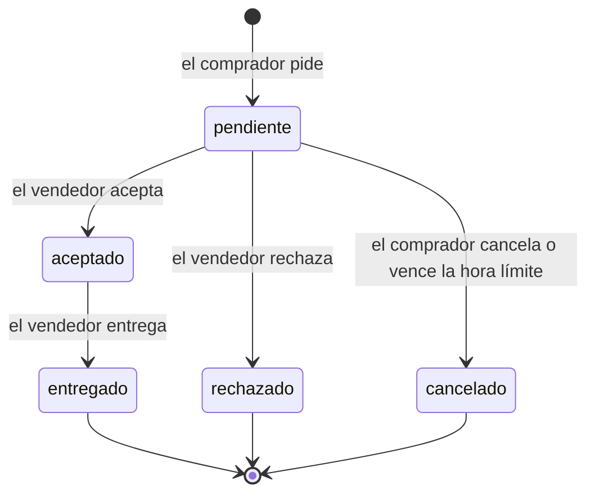

---

## 2. Componentes y métodos

### 2.1 Vista general

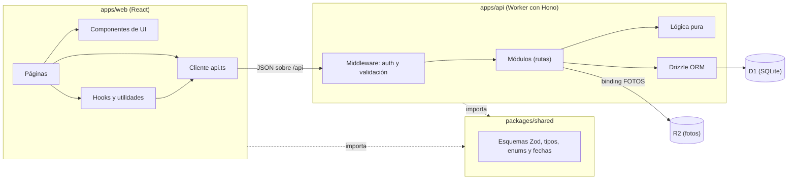

El código usa funciones y módulos de TypeScript, no clases. En los diagramas, **cada clase representa un módulo, una tabla o un objeto**, y sus métodos son las funciones o rutas que expone.

### 2.2 Modelo de dominio

Tablas de D1 (`apps/api/src/db/schema.ts`). Las fechas se guardan como texto ISO y los IDs como UUID en texto.

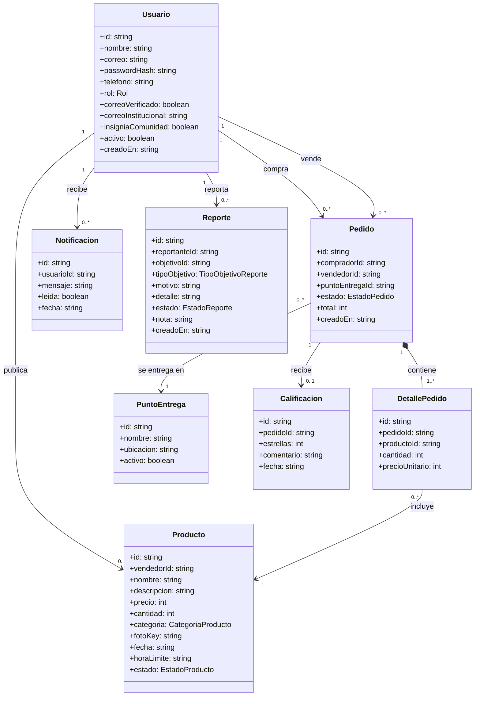

`Reporte.objetivoId` apunta a un usuario o a un producto según `tipoObjetivo`, sin llave foránea. La tabla `codigos_verificacion` también existe, pero está sin uso.

| Enum                  | Valores                                                        |
| --------------------- | -------------------------------------------------------------- |
| `Rol`                 | `usuario`, `admin`                                             |
| `CategoriaProducto`   | `comida`, `bebidas`, `snacks`, `articulos`, `utiles`           |
| `EstadoProducto`      | `disponible`, `agotado`, `oculto`                              |
| `EstadoPedido`        | `pendiente`, `aceptado`, `rechazado`, `entregado`, `cancelado` |
| `EstadoReporte`       | `abierto`, `resuelto`, `descartado`                            |
| `TipoObjetivoReporte` | `usuario`, `producto`                                          |

### 2.3 Backend: módulos de la API

Cada módulo es un router de Hono en `apps/api/src/modules/<recurso>/routes.ts`, montado bajo `/api`. Las rutas son funciones anónimas: el nombre del método describe lo que hace la ruta. Los métodos **en cursiva** ya tienen ruta y validación, pero aún responden `501`.

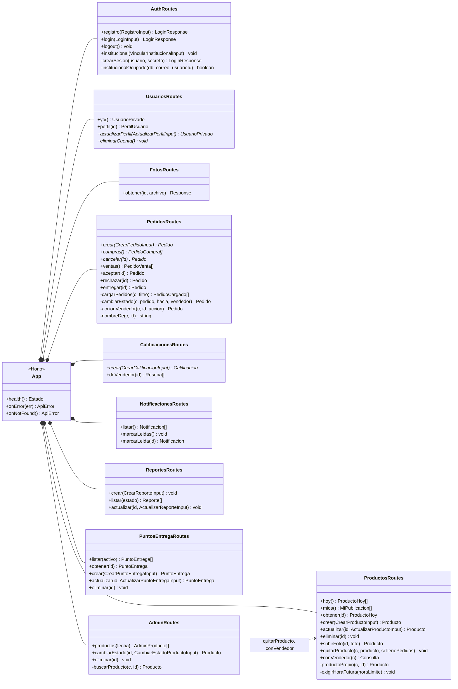

### 2.4 Backend: lógica y utilidades

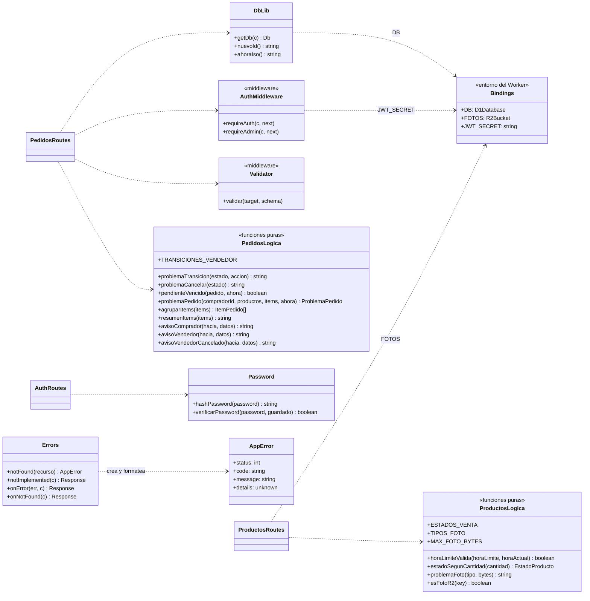

Para no saturar el diagrama solo se dibujan las dependencias propias de cada router. Los demás también usan `DbLib`, `Validator` y `AuthMiddleware` según lo que necesitan.

### 2.5 Paquete compartido

`packages/shared` define el contrato entre web y API: ambos importan los mismos esquemas y tipos.

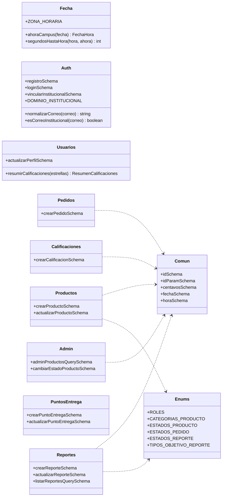

### 2.6 Frontend: cliente de la API y utilidades

Todas las pantallas hablan con el backend por `apps/web/src/lib/api.ts`. Los métodos **en cursiva** faltan por agregar al cliente. De `Formato` solo se muestran las funciones principales.

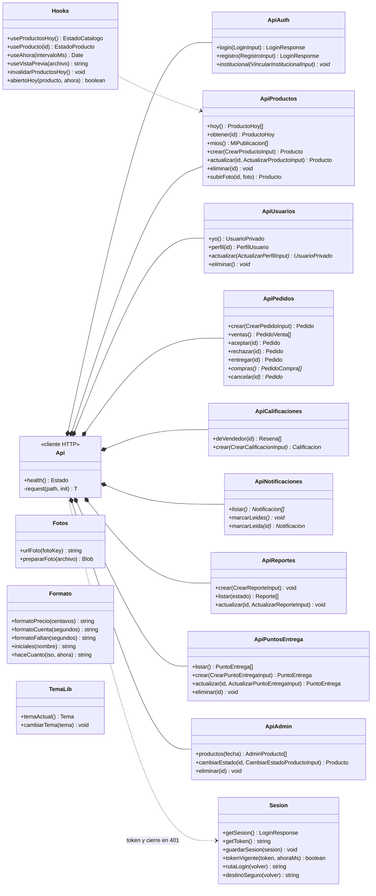

### 2.7 Frontend: páginas y componentes

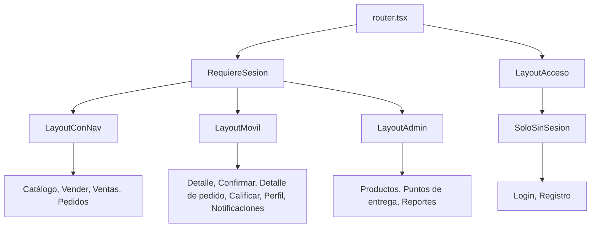

| Ruta                      | Página                      | Datos                                             |
| ------------------------- | --------------------------- | ------------------------------------------------- |
| `/`                       | `CatalogoPage`              | API (el contador de notificaciones es de ejemplo) |
| `/vender`                 | `VenderPage`                | API                                               |
| `/ventas`                 | `VentasPage`                | API                                               |
| `/pedidos`                | `PedidosPage`               | De ejemplo                                        |
| `/producto/:id`           | `DetallePage`               | API                                               |
| `/producto/:id/confirmar` | `ConfirmarPage`             | API (crear el pedido aún responde `501`)          |
| `/pedidos/:id`            | `PedidoDetallePage`         | De ejemplo                                        |
| `/calificar/:pedidoId`    | `CalificarPage`             | De ejemplo                                        |
| `/perfil/:id`             | `PerfilPage`                | API                                               |
| `/notificaciones`         | `NotificacionesPage`        | De ejemplo                                        |
| `/admin`                  | `AdminProductosPage`        | API                                               |
| `/admin/puntos`           | `AdminPuntosPage`           | API                                               |
| `/admin/reportes`         | `AdminReportesPage`         | API                                               |
| `/login`, `/registro`     | `LoginPage`, `RegistroPage` | API                                               |

Componentes de UI reutilizables (`apps/web/src/components`):

| Grupo      | Componentes                                                                                                             |
| ---------- | ----------------------------------------------------------------------------------------------------------------------- |
| Layout     | `LayoutConNav`, `LayoutMovil`, `LayoutAcceso`, `LayoutAdmin`, `NavInferior`, `NavSuperior`, `MenuCuenta`, `BarraAccion` |
| Acceso     | `RequiereSesion`, `SoloSinSesion`                                                                                       |
| Producto   | `Tarjeta`, `FotoProducto`, `ChipHasta`, `ChipFaltan`, `BarraExistencias`, `SelectorCantidad`                            |
| Estado     | `PastillaEstado`, `PastillaReporte`, `PastillaCantidad`, `TarjetaSkeleton`, `ProntoSkeleton`                            |
| Persona    | `Avatar`, `Insignia`, `InsigniaMini`, `SinVerificar`, `Estrellas`                                                       |
| Formulario | `Boton`, `BotonRedondo`, `Chip`, `Etiqueta`                                                                             |
| Marca      | `LogoShopsito`                                                                                                          |

### 2.8 Endpoints de la API

Estado: ✅ implementado · ⏳ responde `501`. Acceso: **público**, **sesión** (JWT) o **admin**.

| Método   | Ruta                                | Acceso  | Estado | Qué hace                                           |
| -------- | ----------------------------------- | ------- | :----: | -------------------------------------------------- |
| `GET`    | `/api/health`                       | público |   ✅   | Comprueba que la API responde                      |
| `POST`   | `/api/auth/registro`                | público |   ✅   | Crea la cuenta y abre la sesión                    |
| `POST`   | `/api/auth/login`                   | público |   ✅   | Devuelve el token (7 días)                         |
| `POST`   | `/api/auth/logout`                  | sesión  |   ✅   | Responde 204; el cliente descarta el token         |
| `POST`   | `/api/auth/institucional`           | sesión  |   ✅   | Liga el correo de la uni y da la insignia          |
| `GET`    | `/api/usuarios/me`                  | sesión  |   ✅   | Datos privados de la cuenta                        |
| `PATCH`  | `/api/usuarios/me`                  | sesión  |   ⏳   | Edita nombre y teléfono                            |
| `DELETE` | `/api/usuarios/me`                  | sesión  |   ⏳   | Baja lógica de la cuenta                           |
| `GET`    | `/api/usuarios/:id`                 | sesión  |   ✅   | Perfil público con ventas y calificaciones         |
| `GET`    | `/api/productos/hoy`                | sesión  |   ✅   | Catálogo del día                                   |
| `GET`    | `/api/productos/mios`               | sesión  |   ✅   | Lo publicado hoy, con vendidos e ingresos          |
| `GET`    | `/api/productos/:id`                | sesión  |   ✅   | Detalle de un producto                             |
| `POST`   | `/api/productos`                    | sesión  |   ✅   | Publica para hoy                                   |
| `PATCH`  | `/api/productos/:id`                | dueño   |   ✅   | Edita la publicación                               |
| `DELETE` | `/api/productos/:id`                | dueño   |   ✅   | Quita la publicación (agotada si ya tiene pedidos) |
| `POST`   | `/api/productos/:id/foto`           | dueño   |   ✅   | Sube la foto a R2 (máximo 5 MB)                    |
| `GET`    | `/api/fotos/productos/:id/:archivo` | público |   ✅   | Sirve la foto desde R2                             |
| `POST`   | `/api/pedidos`                      | sesión  |   ⏳   | Crea el pedido y aparta inventario                 |
| `GET`    | `/api/pedidos/compras`              | sesión  |   ⏳   | Pedidos que hizo el usuario                        |
| `GET`    | `/api/pedidos/ventas`               | sesión  |   ✅   | Pedidos que le hicieron hoy                        |
| `POST`   | `/api/pedidos/:id/aceptar`          | dueño   |   ✅   | Acepta un pedido pendiente                         |
| `POST`   | `/api/pedidos/:id/rechazar`         | dueño   |   ✅   | Rechaza y devuelve el inventario                   |
| `POST`   | `/api/pedidos/:id/entregar`         | dueño   |   ✅   | Marca como entregado                               |
| `POST`   | `/api/pedidos/:id/cancelar`         | sesión  |   ⏳   | El comprador cancela un pendiente                  |
| `POST`   | `/api/calificaciones`               | sesión  |   ⏳   | Califica un pedido entregado                       |
| `GET`    | `/api/calificaciones/vendedor/:id`  | sesión  |   ✅   | Reseñas de un vendedor                             |
| `GET`    | `/api/notificaciones`               | sesión  |   ✅   | Últimas 100 notificaciones                         |
| `PATCH`  | `/api/notificaciones/leidas`        | sesión  |   ✅   | Marca todas como leídas                            |
| `PATCH`  | `/api/notificaciones/:id/leida`     | sesión  |   ✅   | Marca una como leída                               |
| `POST`   | `/api/reportes`                     | sesión  |   ✅   | Reporta a un usuario o una publicación             |
| `GET`    | `/api/reportes`                     | admin   |   ✅   | Lista reportes (filtro por estado)                 |
| `PATCH`  | `/api/reportes/:id`                 | admin   |   ✅   | Resuelve o descarta, con nota                      |
| `GET`    | `/api/puntos-entrega`               | sesión  |   ✅   | Lista puntos (filtro por activo)                   |
| `GET`    | `/api/puntos-entrega/:id`           | sesión  |   ✅   | Un punto de entrega                                |
| `POST`   | `/api/puntos-entrega`               | admin   |   ✅   | Crea un punto                                      |
| `PATCH`  | `/api/puntos-entrega/:id`           | admin   |   ✅   | Edita o desactiva un punto                         |
| `DELETE` | `/api/puntos-entrega/:id`           | admin   |   ✅   | Borra un punto sin pedidos                         |
| `GET`    | `/api/admin/productos`              | admin   |   ✅   | Todo lo publicado en un día                        |
| `PATCH`  | `/api/admin/productos/:id`          | admin   |   ✅   | Oculta o vuelve a mostrar                          |
| `DELETE` | `/api/admin/productos/:id`          | admin   |   ✅   | Borra la publicación (oculta si ya tiene pedidos)  |

**Dueño** significa con sesión y además ser quien vende ese producto o pedido. Los errores siempre tienen la forma `{ "error": { "code": "…", "message": "…" } }`.

---

## 3. Stack tecnológico

| Capa             | Tecnología                                                | Para qué                                        |
| ---------------- | --------------------------------------------------------- | ----------------------------------------------- |
| Lenguaje         | TypeScript ~6.0                                           | Todo el proyecto                                |
| Monorepo         | pnpm 10.34 workspaces, Node.js 24                         | `apps/web`, `apps/api`, `packages/shared`       |
| Frontend         | React 19, React Router 8, Vite 8                          | SPA responsive                                  |
| Estilos          | Tailwind CSS 4, lucide-react                              | Tokens del tema, modo oscuro e iconos           |
| Backend          | Hono 4 sobre Cloudflare Workers                           | API REST                                        |
| Validación       | Zod 4, `@hono/zod-validator`                              | Contrato compartido entre web y API             |
| Base de datos    | Cloudflare D1 (SQLite), Drizzle ORM 0.45, drizzle-kit     | Datos y migraciones                             |
| Archivos         | Cloudflare R2                                             | Fotos de productos                              |
| Autenticación    | JWT HS256 (7 días), PBKDF2-SHA256 con WebCrypto           | Sesión sin estado y contraseñas                 |
| Hosting web      | Cloudflare Pages y Pages Functions                        | Archivos estáticos y proxy de `/api`            |
| Infraestructura  | Terraform ≥ 1.6 (providers Cloudflare 5.29 y Random 3)    | Recursos de dev y prod                          |
| CI/CD            | GitHub Actions, Wrangler 4                                | Checks, despliegue y migraciones                |
| Pruebas          | Vitest 5                                                  | Pruebas unitarias                               |
| Calidad          | ESLint 10, typescript-eslint 8, Prettier 3                | Lint y formato                                  |
| Desarrollo local | Docker Compose, Dev Containers, Wrangler (simula D1 y R2) | Ambiente igual para el equipo, sin usar la nube |

---

## 4. Recursos que se van a crear

Todo vive en una cuenta de Cloudflare y lo crea Terraform (`infra/terraform/modules/shopsito`). Hay dos ambientes idénticos y separados: **dev** y **prod**.

### 4.1 Inventario

| Recurso                  | Recurso de Terraform                  | dev                  | prod                     |
| ------------------------ | ------------------------------------- | -------------------- | ------------------------ |
| Base de datos D1         | `cloudflare_d1_database`              | `shopsito-db-dev`    | `shopsito-db-prod`       |
| Bucket R2 de fotos       | `cloudflare_r2_bucket`                | `shopsito-fotos-dev` | `shopsito-fotos-prod`    |
| Worker de la API         | `cloudflare_workers_script`           | `shopsito-api-dev`   | `shopsito-api-prod`      |
| Subdominio `workers.dev` | `cloudflare_workers_script_subdomain` | activado             | desactivado              |
| Proyecto de Pages        | `cloudflare_pages_project`            | `shopsito-web-dev`   | `shopsito-web-prod`      |
| Secreto `JWT_SECRET`     | `random_password`                     | aleatorio (64)       | aleatorio (64), distinto |

Fuera del módulo:

| Recurso                                                  | Cómo se crea          | Para qué                               |
| -------------------------------------------------------- | --------------------- | -------------------------------------- |
| Bucket R2 privado `shopsito-tfstate`                     | Una vez, con Wrangler | Estado de Terraform de ambos ambientes |
| Environments `dev` y `prod` en GitHub                    | A mano, en Settings   | Aprobación manual antes de prod        |
| Secrets `CLOUDFLARE_API_TOKEN` y `CLOUDFLARE_ACCOUNT_ID` | A mano, en Settings   | Credenciales del despliegue            |

D1 y R2 se crean con ubicación sugerida `wnam` (oeste de Norteamérica).

### 4.2 Diagrama de infraestructura

Un ambiente (`amb` es `dev` o `prod`):

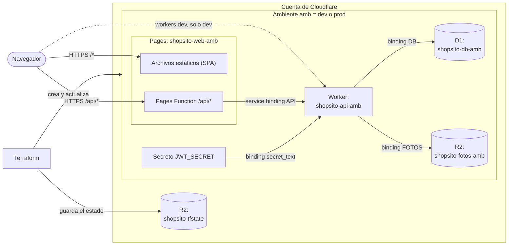

La web llama a `/api` en su mismo origen, así que no hace falta CORS.

### 4.3 Dependencias entre recursos

Orden en que Terraform crea los recursos: primero aquello de lo que dependen los demás.

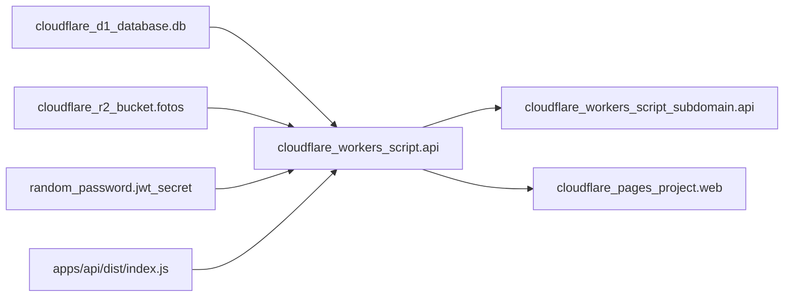

---

## 5. Diagrama de deployment

### 5.1 Nodos y artefactos

En la nube (igual para dev y prod):

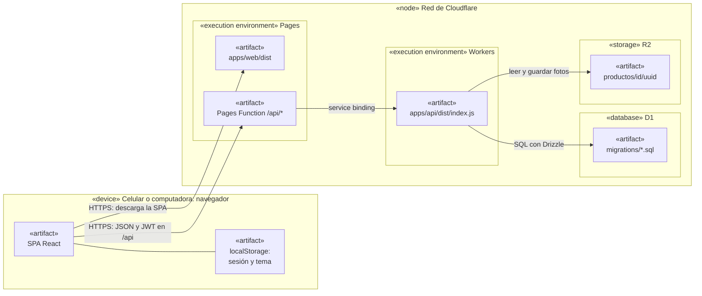

En la computadora de cada quien, sin usar la nube:

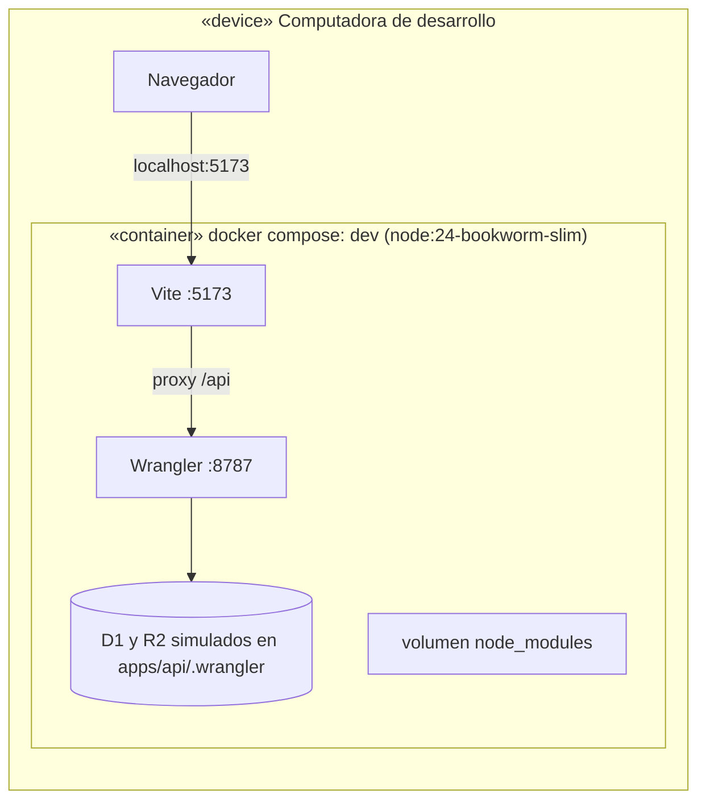

### 5.2 Flujo de despliegue (CI/CD)

`.github/workflows/desplegar.yml` corre los checks en cada PR. En cada push a `main` corre los checks, despliega a dev y, con aprobación, a prod.

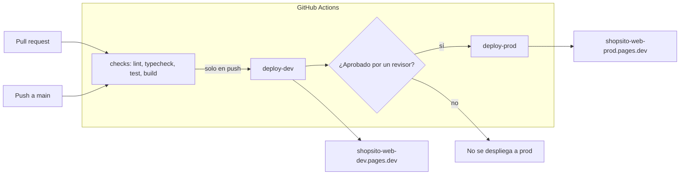

### 5.3 Pasos de un despliegue

Cada despliegue corre `infra/desplegar.sh <amb>`:

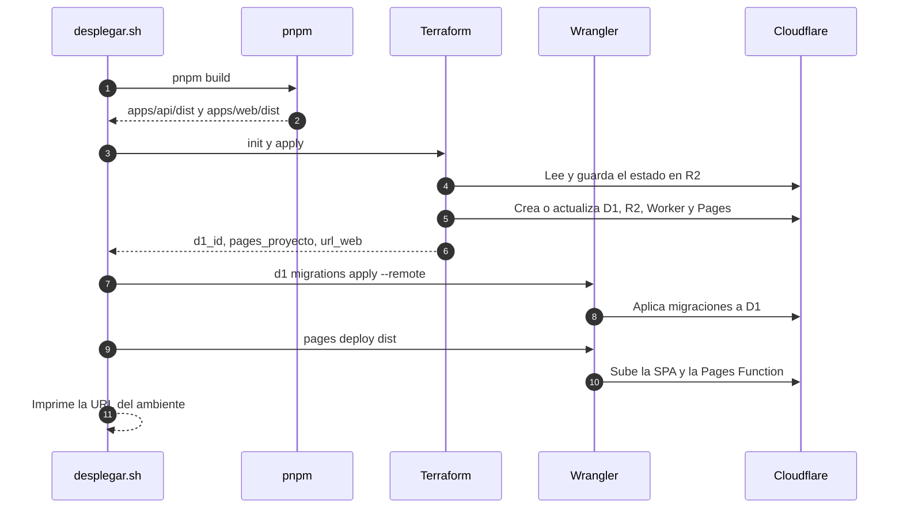

Los detalles para configurarlo y operarlo están en [`infra/README.md`](../infra/README.md).
